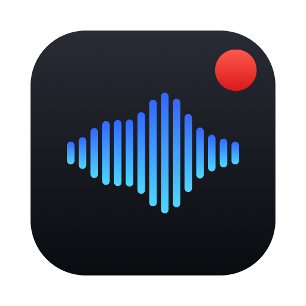
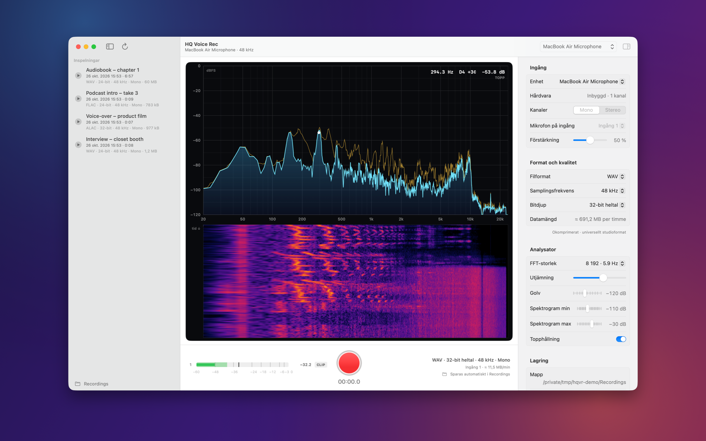
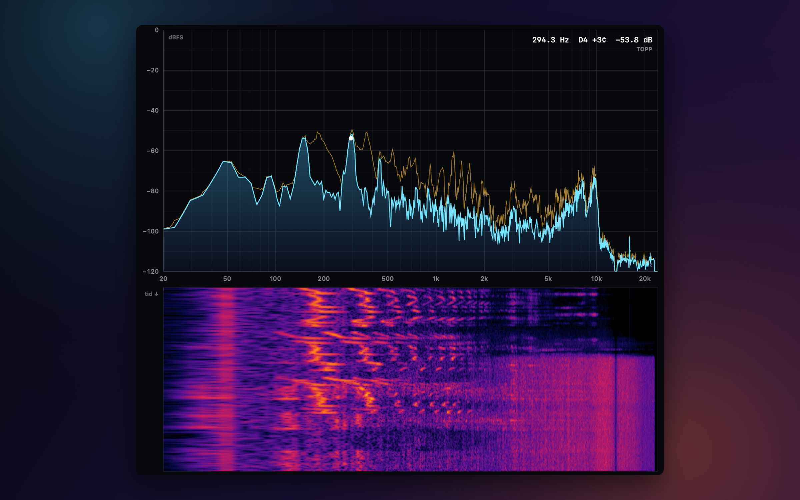
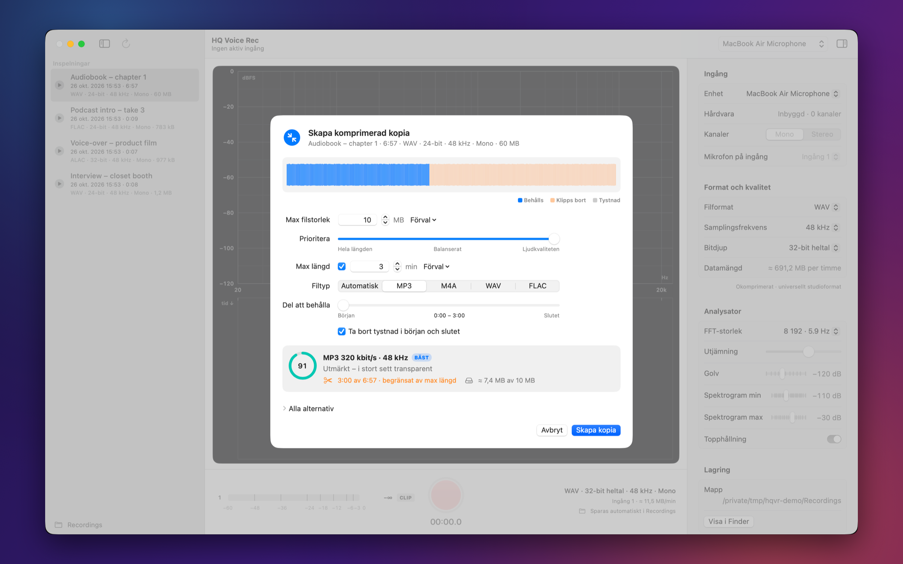

<div align="center">



# HQ Voice Rec

**Studio-grade voice recording for macOS, with a live spectrum analyzer.**

Raw, unprocessed capture straight from your microphone, saved automatically in the format you choose,
plus a smart exporter that fits any take under a size or length limit without wrecking the sound.

[](#requirements)
[](#requirements)
[](#build-from-source)
[](#architecture)

[**Download the latest release**](../../releases/latest) · [Features](#features) · [Install](#install) · [Build](#build-from-source)

<br>



</div>

---

## Features

### 🎙 Recording without compromises
- **Raw capture through CoreAudio (AUHAL).** No automatic gain, noise suppression or voice processing: you get exactly what your microphone and interface deliver, as 32-bit float internally.
- **Pick any input device and channel.** Record a dynamic mic on input 2 of an eight-channel interface in mono, or a stereo pair. The hardware input gain is exposed when the device supports it.
- **Up to 192 kHz / 32-bit.** Sample rates are read from the device and the hardware clock is switched to match, so nothing is resampled on the way in.
- **Formats:** WAV, AIFF, CAF (16/24/32-bit integer or 32-bit float), FLAC and Apple Lossless (16/24-bit), and AAC (128–320 kbit/s). 16-bit output gets optional TPDF dither.
- **Saved automatically.** Audio streams to disk while you record and the file is finalised the moment you stop, even if you quit the app mid-take. Everything lands in `~/Documents/Recordings`.
- **Lock-free audio path.** A real-time-safe ring buffer separates the I/O thread from disk writes and analysis, so a busy UI can never cause a dropout. Dropouts are detected and flagged anyway.

### 📈 Live analyzer, Spectroid style


- Hann-windowed FFT (2 048–32 768 points) on a **logarithmic 20 Hz – Nyquist axis**, calibrated so a full-scale sine reads 0 dBFS.
- Smoothed spectrum with **peak hold**, plus a scrolling **spectrogram** with a magma-style colour map.
- **Dominant peak read-out** with parabolic interpolation, note name and cents (`294.3 Hz · D4 +3¢`).
- **Hover anywhere** for the exact frequency, note and level under the cursor.
- **Peak/RMS meters** with peak hold and a latching clip indicator.

### 🗜 Smart compressed copies


Right-click any recording and choose **Create compressed copy…** (or press **⌘E**). Tell it the maximum file size,
optionally a maximum length and file type, and it finds the best possible file:

1. **Measures, doesn't guess.** Every candidate format (lossless FLAC/WAV, AAC and MP3 ladders) is test-encoded on a sample of *your* audio, in parallel, to learn its real size: fixed container overhead plus bytes per second.
2. **Scores the trade-off.** A single slider balances *keep the whole length* against *keep the quality*; each candidate is scored on perceived quality and how much of the clip fits.
3. **Verifies on disk.** The chosen file is encoded, its real size is checked, and the cut is refitted until it sits just under the limit. It is never over.

Silence at the start and end is trimmed first (that costs nothing), cuts get short fades, you choose which part of the clip
to keep, and the result is saved next to the original. A **Higgsfield (3 min, MP3)** preset is built in.

MP3 files carry a LAME Info frame and M4A files are rewritten **fast-start** (index before the audio), so upload
sites that only inspect the first part of a file still see the correct duration.

### ✨ Native macOS
SwiftUI with a sidebar library, an inspector and a unified toolbar. Light and dark mode (or force one in the inspector),
built-in playback, Show in Finder, and Move to Trash.

---

## Install

1. Download **`HQ-Voice-Rec-<version>-arm64.dmg`** from [Releases](../../releases/latest).
2. Open it and drag **HQ Voice Rec** to **Applications**.
3. The app is not notarised, so the first launch needs one extra step: **right-click the app → Open → Open**.
   Alternatively, clear the download quarantine flag:
   ```bash
   xattr -dr com.apple.quarantine "/Applications/HQ Voice Rec.app"
   ```
4. Allow microphone access when macOS asks.

### Requirements
- macOS 15 Sequoia or later
- Apple Silicon (arm64)

> The interface is in Swedish.

---

## Usage

| Action | How |
|---|---|
| Start / stop recording | **Space** or **⌘R** (the file is saved automatically on stop) |
| Create compressed copy | Right-click a recording, or select it and press **⌘E** |
| Reset clip indicators | **⌘K** or click **CLIP** |
| Open the recordings folder | **⇧⌘O** |
| Delete a recording | **⌫** (moves it to the Trash) |

### Automation
HQ Voice Rec registers the `hqvoicerec://` URL scheme, which works with Shortcuts, Stream Deck, Raycast or a terminal:

```bash
open hqvoicerec://record     # start recording
open hqvoicerec://stop       # stop and save
open hqvoicerec://toggle     # start or stop
open hqvoicerec://compress   # compressed-copy sheet for the selected (or newest) take
```

### Custom recordings folder
```bash
defaults write se.william.hqvoicerec RecordingsFolder "~/Music/Takes"
```
or, for a single launch: `open -a "HQ Voice Rec" --args -RecordingsFolder ~/Music/Takes`.

### Tips for dynamic microphones
- Set the gain on your interface so peaks land around **−12 to −6 dBFS**. 24-bit gives about 144 dB of dynamic range, so there is no need to record hot.
- Use the spectrogram to spot hum (a bright line at 50/60 Hz and its harmonics) and room noise before you record.

---

## Build from source

Requires the Xcode Command Line Tools (Swift 6) and LAME for MP3 export:

```bash
brew install lame
git clone https://github.com/333william333/hq-voice-rec.git
cd hq-voice-rec
./build-app.sh                 # → build/HQ Voice Rec.app (ad-hoc signed)
./scripts/release.sh 1.0.0     # → dist/ DMG + zip
```

LAME and mpg123 are linked **statically**, so the built app has no runtime dependency on Homebrew.

---

## Architecture

```
Sources/HQVoiceRec
├── Audio/
│   ├── AudioCapture.swift       AUHAL input unit, real-time render callback
│   ├── RingBuffer.swift         lock-free SPSC float FIFO (Swift Atomics)
│   ├── AudioProcessor.swift     metering, FFT, spectrogram, disk streaming
│   ├── RecordingWriter.swift    AVAudioFile writer, SRC, TPDF dither
│   ├── RecordingSettings.swift  formats, bit depths, sample rates
│   └── CoreAudioDevices.swift   HAL device, sample-rate and gain helpers
├── DSP/
│   ├── SpectrumAnalyzer.swift   vDSP FFT → log-frequency columns, peak finder
│   └── Waterfall.swift          scrolling spectrogram bitmap
├── Export/
│   ├── CompressionEngine.swift  analysis, size models, planner, verified export
│   ├── CompressionSession.swift state behind the export sheet
│   ├── MP3Encoder.swift         CBR MP3 via LAME, with Info frame
│   └── FastStart.swift          moves the MP4 `moov` atom to the front
├── Views/                       SwiftUI: spectrum canvas, meters, sidebar, inspector, export sheet
├── AppModel.swift               app state, devices, library, URL commands
└── HQVoiceRecApp.swift
```

**Signal path:** microphone → AUHAL (render callback, real-time thread) → lock-free ring buffer → processing queue → { file writer · peak/RMS meters · FFT → spectrum + spectrogram } → SwiftUI `Canvas` at display refresh rate.

---

## Credits

- MP3 encoding by [LAME](https://lame.sourceforge.io) (LGPL), statically linked.
- Everything else uses Apple frameworks only: CoreAudio, AVFoundation, Accelerate and SwiftUI.
